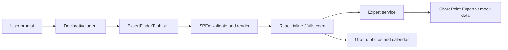

# Expert Finder: code walkthrough for conference slides

Based on the deployed repository implementation, reviewed on 2026-11-05. Stack: SPFx 1.24.1, React 18, TypeScript, Fluent UI v9 and Microsoft Graph v1.0.

Use each numbered section as a slide topic. The quoted speaker lines are suggested narration; the code comes from the linked project files. TypeScript/TSX blocks are selected excerpts with surrounding code omitted. JSON blocks show selected properties, and some arrays show one representative item; they are not replacement configuration files.

For a short walkthrough, use **01–08 and 13–14**. Add **09–12** for Graph interactions and **15** for the user-triggered component-to-Copilot handoff. Put secondary snippets in speaker notes or split them across slides; keep one code block visible at a time.

## The story to tell

Copilot translates a request into a tool name and a skill argument. SPFx validates that argument, hosts React and supplies authenticated clients. Application code retrieves data and handles interactions. Expert search uses a SharePoint list; Graph adds photos and calendar features.



**Opening line:** “The model chooses the action and its arguments. Our component owns the data, the interface and the user-confirmed actions.”

The current demo has four canonical skills: `SPFx`, `Copilot`, `DB` and `Spanish`. The list uses a **single-choice `Skill`** field, and each result represents one person/skill record. Name, department and role are further local filters.

## 01. Give the agent a clear job

**Files:** [copilot/declarativeAgent.json](../copilot/declarativeAgent.json), [copilot/instruction.txt](../copilot/instruction.txt).

```json
{
  "version": "v1.8",
  "name": "Expert Finder",
  "instructions": "$[file('instruction.txt')]",
  "conversation_starters": [
    {
      "title": "Find an SPFx expert",
      "text": "Who can help me with SPFx?"
    }
  ],
  "actions": [
    {
      "id": "expertFinderAction",
      "file": "ai-plugin.json"
    }
  ]
}
```

The instructions contain the routing rule below:

```text
When a user wants to find a person with a supported skill, invoke ExpertFinderTool with one canonical skill argument. The component retrieves the matching profiles and renders the authoritative interactive results; you do not perform the search yourself.
```

**Explain:** The agent definition references the instructions file and an action definition. Starters illustrate supported intents. Instructions map natural language such as “databases” to `DB` and tell Copilot to ask when the skill is ambiguous. They do not implement the search.

**Say:** “Users ask for a colleague; they do not need to know our tool's name.”

## 02. Expose a tool with a typed input contract

**Files:** [src/copilotComponents/expertFinder/ExpertFinderCopilotComponent.manifest.json](../src/copilotComponents/expertFinder/ExpertFinderCopilotComponent.manifest.json), [src/copilotComponents/expertFinder/ExpertFinderCopilotComponentProperties.ts](../src/copilotComponents/expertFinder/ExpertFinderCopilotComponentProperties.ts).

```json
{
  "id": "980d322c-2c03-4d8b-a05a-6b724ee174a1",
  "componentType": "CopilotComponent",
  "copilotType": "Ux",
  "capabilities": {
    "availableDisplayModes": [
      "inline",
      "fullscreen"
    ]
  },
  "tools": [
    {
      "name": "ExpertFinderTool",
      "description": {
        "default": "Find people with expertise in SPFx, Copilot, databases (DB), or Spanish. Render an interactive Expert Finder directory with matching experts, local name/department/role filters and contact actions. Use when the user asks who can help with one of these skills."
      },
      "propertiesSchema": {
        "id": "$../../../lib/copilotComponents/expertFinder/ExpertFinderCopilotComponentProperties.js:default;"
      }
    }
  ]
}
```

The tool description in the same manifest tells Copilot when to find people and render this directory. Its properties schema points to the compiled export of this TypeScript file:

```typescript
import { z } from 'zod';

export const propertiesSchema = z.strictObject({
  skill: z.string().min(1).max(80).describe(
    'The skill the user wants to find an expert in. Use one canonical value: SPFx, Copilot, DB, or Spanish. Map SharePoint Framework to SPFx and database expertise to DB.'
  )
});

export type IExpertFinderCopilotComponentProperties = z.infer<typeof propertiesSchema>;

export default z.toJSONSchema(propertiesSchema, { target: 'draft-7' });
```

**Explain:** The SPFx component manifest exposes `ExpertFinderTool` and declares both display modes. Zod defines runtime constraints; `z.infer` supplies TypeScript props and `z.toJSONSchema` exports Draft 7 JSON Schema for tooling. The generated argument is as small as `{"skill":"SPFx"}`.

The `.describe()` text guides the model; it is not an enum validator. The entry point also calls `normalizeSkill` to enforce the four supported values after `safeParse`.

**Say:** “One schema connects model-visible arguments, TypeScript types and runtime validation.”

## 03. Connect the baseline agent to the component

**Files:** [config/copilot-agent.json](../config/copilot-agent.json), [copilot/ai-plugin.json](../copilot/ai-plugin.json).

```json
{
  "agents": [
    {
      "name": {
        "default": "Expert Finder"
      },
      "description": {
        "default": "Find experts by skill and explore their profiles directly in Copilot."
      },
      "components": [
        "980d322c-2c03-4d8b-a05a-6b724ee174a1"
      ]
    }
  ]
}
```

The action seed supplies the plugin identity and its descriptions:

```json
{
  "schema_version": "v2.4",
  "namespace": "expertFinder",
  "name_for_human": "Expert Finder",
  "description_for_model": "Use ExpertFinderTool to find people who can help with a specific skill. The component retrieves and displays the matching profiles. Do not invent expert identities or search results."
}
```

The build expands that seed. This is selected **generated output** from `ai-plugin.json` inside `teams/expert-finder.zip`, not another source file to maintain:

```json
{
  "functions": [],
  "runtimes": [
    {
      "type": "RemoteMCPServer",
      "auth": {
        "type": "None"
      },
      "spec": {
        "url": "{{TENANT_MCP_URL}}"
      },
      "run_for_functions": [
        "*"
      ]
    }
  ]
}
```

**Explain:** The component GUID in `config/copilot-agent.json` matches the component manifest. Dynamic discovery uses SPFx's managed MCP endpoint; the generated `functions: []` is intentional. We do not hand-maintain a second copy of the tool parameters in the plugin seed. SharePoint resolves `{{TENANT_MCP_URL}}` when synchronizing the baseline agent.

The generated runtime's `auth` field is not a Graph permission grant. Our data services still use the delegated clients supplied by SPFx.

**Say:** “The build connects these files; we are not hosting an extra MCP server for this demo.”

## 04. Enter through SPFx, then render React

**Files:** [src/copilotComponents/expertFinder/ExpertFinderCopilotComponent.tsx](../src/copilotComponents/expertFinder/ExpertFinderCopilotComponent.tsx), [src/copilotComponents/expertFinder/utils/skills.ts](../src/copilotComponents/expertFinder/utils/skills.ts).

```tsx
export default class ExpertFinderCopilotComponent extends BaseCopilotComponent<IExpertFinderCopilotComponentProperties> {
  private _root: Root | undefined;
```

Initialization selects the provider once per component instance:

```tsx
const selection = await createExpertService(this.context.spHttpClient, this.context.pageContext.web.absoluteUrl);
this._service = selection.service;
this._isDemo = selection.isDemo;
```

Rendering treats the tool arguments as untrusted input:

```tsx
const input = propertiesSchema.safeParse(this.properties);
const skill = input.success ? normalizeSkill(input.data.skill) : undefined;
```

The entry builds `IExpertFinderProps` with the validated skill, services, host context and callbacks. React mounts into the host-owned element:

```tsx
if (!this._root) this._root = createRoot(this.context.domElement);
this._root.render(React.createElement(ExpertFinder, props));
```

**Explain:** `BaseCopilotComponent` supplies the SPFx and Copilot context. `onInit` composes services; `render` validates current arguments and passes explicit props to React. Reusing the React root avoids remounting the app for ordinary host updates. `onTeardown` unmounts React and disposes Graph services, photo Blob URLs and in-memory booking state.

**Say:** “This is an SPFx entry point with a Copilot host, followed by ordinary React.”

## 05. Let the host control fullscreen and theme

**Files:** [src/copilotComponents/expertFinder/ExpertFinderCopilotComponent.tsx](../src/copilotComponents/expertFinder/ExpertFinderCopilotComponent.tsx), [src/copilotComponents/expertFinder/components/ExpertFinder.tsx](../src/copilotComponents/expertFinder/components/ExpertFinder.tsx), [src/copilotComponents/expertFinder/components/ExpertFinderInline.tsx](../src/copilotComponents/expertFinder/components/ExpertFinderInline.tsx).

```tsx
private _requestFullscreen = async (): Promise<void> => {
  const result = await this.requestDisplayModeAsync('fullscreen');
  if (result.mode !== 'fullscreen') throw new Error('Fullscreen is not available in this host.');
};
```

React reads the effective mode and the host's available modes:

```tsx
const fullscreen = props.hostContext.displayMode === 'fullscreen';
const canExpand = !fullscreen && (props.hostContext.availableDisplayModes || []).indexOf('fullscreen') !== -1;
```

The app supplies the host theme and document to Fluent UI. This is the opening JSX from the provider:

```tsx
<FluentProvider theme={props.hostContext.theme === 'dark' ? teamsDarkTheme : teamsLightTheme} targetDocument={props.targetDocument}>
```

**Explain:** A request can be declined; the UI follows `hostContext.displayMode`, not a locally assumed fullscreen flag. The root selects `ExpertFinderInline` or `ExpertFinderFullscreen`. Inline uses `experts.slice(0, 3)` while retaining the full result count. Results, filters and photo state live above the two views, so an ordinary mode change does not reload the directory.

`teamsLightTheme` / `teamsDarkTheme` and Fluent semantic tokens provide the visual theme. `targetDocument` comes from `this.context.domElement.ownerDocument`, including when hosted in an iframe. The fullscreen card's availability selection is deliberately cleared when that view unmounts.

**Say:** “We ask the host to expand; the host tells us which layout and theme are actually active.”

## 06. Keep the UI independent of SharePoint or mocks

**Files:** [src/copilotComponents/expertFinder/services/IExpertService.ts](../src/copilotComponents/expertFinder/services/IExpertService.ts), [src/copilotComponents/expertFinder/services/createExpertService.ts](../src/copilotComponents/expertFinder/services/createExpertService.ts), [src/copilotComponents/expertFinder/models/Expert.ts](../src/copilotComponents/expertFinder/models/Expert.ts).

```typescript
import type { Expert, ExpertSkill } from '../models/Expert';

export interface IExpertService {
  getExpertsBySkill(skill: ExpertSkill): Promise<Expert[]>;
}
```

```typescript
const rootSiteUrl = new URL(contextWebUrl).origin;
const listTitle = 'Experts';
const response = await client.get(
  `${rootSiteUrl}/_api/web/lists/getbytitle('${listTitle}')?$select=Id`,
  SPHttpClient.configurations.v1
);

if (response.status === 404) {
  return { service: new MockExpertService(), isDemo: true };
}
if (response.status !== 200) {
  throw new Error(`Unable to check the Experts list (HTTP ${response.status}). Check your access to the tenant root site.`);
}

return { service: new SharePointExpertService(client, rootSiteUrl, listTitle), isDemo: false };
```

**Explain:** Both providers return the typed `Expert` model. A root-list HTTP 200 selects SharePoint; only HTTP 404 selects mock data. A permissions/network failure remains an error, and an existing empty list stays empty.

This demo derives the tenant root from the origin of the SPFx context URL and expects a list named `Experts` there. It is a controlled convention, not a configurable tenant-discovery service. Mock mode uses bundled portraits and constructs no Graph photo, availability or meeting service.

**Say:** “The same UI works with a real directory or fictional demo records through one small interface.”

## 07. Query the list as the signed-in user

**Files:** [src/copilotComponents/expertFinder/services/SharePointExpertService.ts](../src/copilotComponents/expertFinder/services/SharePointExpertService.ts), [docs/sharepoint-setup.md](../docs/sharepoint-setup.md).

```typescript
const query = new URLSearchParams({
  '$select': 'Id,Title,Skill,ShortCV,Department,Expert/Id,Expert/Title,Expert/Name,Expert/EMail',
  '$expand': 'Expert', '$filter': `Skill eq '${escapeLiteral(skill)}'`, '$orderby': 'Id asc', '$top': '100'
});
const url = `${this._siteUrl}/_api/web/lists/getbytitle('${encodeURIComponent(escapeLiteral(this._listTitle))}')/items?${query.toString()}`;
const response = await this._client.get(url, SPHttpClient.configurations.v1, {
  headers: { Accept: 'application/json;odata=nometadata', 'odata-version': '' }
});
```

The Person field's membership login and email serve different operations:

```typescript
const login = item.Expert.Name || '';
const prefix = 'i:0#.f|membership|';
const principal = login.indexOf(prefix) === 0 ? login.substring(prefix.length) : undefined;
const userPrincipalName = getTeamsChatUrl(principal) ? principal : undefined;
const email = z.email().safeParse(typeof item.Expert.EMail === 'string' ? item.Expert.EMail.trim() : undefined);
```

**Explain:** `SPHttpClient` uses the current user's SharePoint permissions. The canonical skill is filtered on the server, the Person field is expanded and the response is checked with Zod before mapping to `Expert`. The demo rejects pagination beyond 100 results per skill rather than silently truncating a larger directory.

| SharePoint field | UI/domain use |
| --- | --- |
| `Title` | `jobTitle` |
| `Skill` | One canonical `ExpertSkill` |
| `Expert/Title` | `displayName` |
| `Expert/Name` | Verified membership UPN for photos and Teams chat |
| `Expert/EMail` | SMTP address for calendar reads and meeting invitations |
| `ShortCV`, `Department` | Summary and department |

Normalization accepts casing/whitespace variants of supported input. The list stores canonical single-choice values. The deployed code queries SharePoint by skill; it does not download all experts for a model to search.

**Say:** “SharePoint stores the directory and enforces access. The model never supplies an OData query.”

## 08. Use React for the interactions after the first render

**Files:** [src/copilotComponents/expertFinder/components/ExpertFinderFullscreen.tsx](../src/copilotComponents/expertFinder/components/ExpertFinderFullscreen.tsx), [src/copilotComponents/expertFinder/utils/expertFilters.ts](../src/copilotComponents/expertFinder/utils/expertFilters.ts).

```tsx
const visible = React.useMemo(() => filterExperts(experts, filters), [experts, filters]);
```

```typescript
export function filterExperts(experts: Expert[], filters: ExpertFilters): Expert[] {
  const name = normalizeText(filters.name);
  return experts.filter(expert => normalizeText(expert.displayName).indexOf(name) === 0
    && (!filters.department || normalizeText(expert.department) === normalizeText(filters.department))
    && (!filters.role || normalizeText(expert.jobTitle) === normalizeText(filters.role)));
```

**Explain:** Fullscreen filters operate on the already loaded skill results. Name is a case-insensitive prefix search; department and role are normalized equality filters. Typing, clearing filters or changing layout does not call another LLM or reload SharePoint. A new skill is a new Copilot invocation.

**Say:** “Once Copilot has opened the app, these controls are React state and JavaScript.”

## 09. Optional: show Graph photos without blocking the cards

**Files:** [src/copilotComponents/expertFinder/services/GraphPhotoService.ts](../src/copilotComponents/expertFinder/services/GraphPhotoService.ts), [src/copilotComponents/expertFinder/components/ExpertAvatar.tsx](../src/copilotComponents/expertFinder/components/ExpertAvatar.tsx).

```typescript
if (!this._client) this._client = this._factory.getClient('3');
const client = await this._client;
if (this._disposed || expired) return undefined;
// The SDK parses image content as Blob. Use $value to retrieve pixels, not metadata.
// https://learn.microsoft.com/en-us/graph/api/profilephoto-get?view=graph-rest-1.0
const photo: unknown = await client.api(`/users/${encodeURIComponent(principal)}/photo/$value`).version('v1.0').get();
```

After validating the returned Blob, the service creates a local image URL:

```typescript
const url = URL.createObjectURL(photo);
this._urls.add(url);
return url;
```

The avatar shows a circular Fluent shimmer while the photo is loading:

```tsx
{loading && <Skeleton className={styles.skeleton} animation="wave"><SkeletonItem shape="circle" size={size} /></Skeleton>}
```

**Explain:** The cards render before photo downloads complete. The app starts photo loads for the small skill result set in parallel. A per-UPN promise cache reuses in-flight and completed requests across filters and mode changes. The service bounds the Graph request; the avatar separately bounds image loading and falls back to initials. Blob URLs are revoked at teardown.

`/photo` returns metadata; `/photo/$value` returns the image. SPFx's `MSGraphClientV3` supplies delegated authentication. The conference tenant reuses `User.ReadBasic.All`; the dedicated photo permission and compatible alternatives are described in the [Graph photo API](https://learn.microsoft.com/en-us/graph/api/profilephoto-get?view=graph-rest-1.0#permissions).

**Say:** “The directory appears first; Graph enriches each card progressively.”

## 10. Optional: load availability only when requested

**Files:** [src/copilotComponents/expertFinder/services/GraphAvailabilityService.ts](../src/copilotComponents/expertFinder/services/GraphAvailabilityService.ts), [src/copilotComponents/expertFinder/components/ExpertAvailabilityPanel.tsx](../src/copilotComponents/expertFinder/components/ExpertAvailabilityPanel.tsx).

```typescript
response = await client.api('/me/calendar/getSchedule').version('v1.0').post({
  schedules: [email], availabilityViewInterval: 30,
  startTime: { dateTime: start.toISOString().slice(0, 19), timeZone: 'UTC' },
  endTime: { dateTime: end.toISOString().slice(0, 19), timeZone: 'UTC' }
});
```

**Explain:** A selected card's Check availability action mounts the panel and triggers one read for that expert's SMTP address. The service constructs today's 09:00–18:00 in the viewer's local zone, then sends UTC boundaries with a 30-minute interval. It validates the 18 returned free/busy codes before rendering Free, Tentative, Busy or Out of Office; event details are discarded.

Morning/afternoon arrows slice the same loaded day, with no additional Graph call. Refresh reads again. A minute timer updates the current-slot outline without polling Graph. Mock or inaccessible calendars show an unavailable explanation, not simulated slots. Calendar free/busy is distinct from Teams presence.

The [getSchedule permission table](https://learn.microsoft.com/en-us/graph/api/calendar-getschedule?view=graph-rest-1.0#permissions) lists delegated `Calendars.ReadBasic` and compatible higher calendar scopes.

**Say:** “A small Graph call turns a profile card into a useful calendar interaction.”

## 11. Optional: create a Teams meeting after confirmation

**Files:** [src/copilotComponents/expertFinder/components/ExpertAvailabilityPanel.tsx](../src/copilotComponents/expertFinder/components/ExpertAvailabilityPanel.tsx), [src/copilotComponents/expertFinder/components/MeetingConfirmationDialog.tsx](../src/copilotComponents/expertFinder/components/MeetingConfirmationDialog.tsx), [src/copilotComponents/expertFinder/services/GraphMeetingService.ts](../src/copilotComponents/expertFinder/services/GraphMeetingService.ts).

```tsx
const actionable = canBook && displayedStatus === 'free' && slot.start.getTime() > now.getTime() && !requested;
```

The Create Teams meeting button calls the service only after the user confirms. The service also rejects self invitations, unresolved identities, past/current slots and intervals other than 30 minutes. Before the write, it checks calendar Teams support and rechecks both calendars:

```typescript
schedules: [this.organizer.email, expert.email], availabilityViewInterval: 30,
startTime: { dateTime: slot.start.toISOString().slice(0, 19), timeZone: 'UTC' },
endTime: { dateTime: slot.end.toISOString().slice(0, 19), timeZone: 'UTC' }
```

After both calendars are confirmed Free, the actual event creation is:

```typescript
const response: unknown = await withTimeout(client.api('/me/events').version('v1.0').post({
  subject: `Expert Finder: ${expert.skill} discussion`,
  body: { contentType: 'Text', content: `Discussion about ${expert.skill}.${notes ? `\n\n${notes}` : ''}` },
  start: { dateTime: slot.start.toISOString().slice(0, 19), timeZone: 'UTC' },
  end: { dateTime: slot.end.toISOString().slice(0, 19), timeZone: 'UTC' },
  attendees: [{ emailAddress: { address: expert.email, name: expert.displayName }, type: 'required' }],
  isOnlineMeeting: true, onlineMeetingProvider: 'teamsForBusiness', showAs: 'busy', transactionId
}), 20000, 'Meeting creation could not be confirmed.');
```

**Explain:** The caller is the organizer; the expert is the required attendee. Notes are plain text. The returned `onlineMeeting.joinUrl` is offered through the host's link-opening callback. Delegated `Calendars.ReadWrite` covers this calendar-backed Teams event; a separate `OnlineMeetings.ReadWrite` grant is not needed for this path. Creating an event with attendees sends invitations. See the [create-event API](https://learn.microsoft.com/en-us/graph/api/user-post-events?view=graph-rest-1.0).

A per-interval promise guard blocks duplicate/in-flight attempts, while `transactionId` protects SDK retries. An uncertain POST outcome asks the user to inspect Outlook instead of automatically creating another invitation. A missing Teams link triggers one read of the existing event.

The existing **Schedule** button remains a labeled preview; real creation is reached from a future Free availability slot and its confirmation dialog.

**Say:** “The user confirms the action, React calls Graph and the meeting belongs to the signed-in user's calendar.”

## 12. Optional: keep the booked slot visually consistent

**Files:** [src/copilotComponents/expertFinder/services/GraphMeetingService.ts](../src/copilotComponents/expertFinder/services/GraphMeetingService.ts), [src/copilotComponents/expertFinder/components/ExpertAvailabilityPanel.tsx](../src/copilotComponents/expertFinder/components/ExpertAvailabilityPanel.tsx).

```typescript
const request = this._create(expert, slot, notes.trim(), () => { writeStarted = true; }).then(meeting => {
  // Keep confirmed bookings visible while the attendee's free/busy view catches up.
  if (!this._disposed) this._bookedSlots.add(key);
  return meeting;
```

The timeline combines confirmed local bookings with the latest Graph result:

```tsx
const booked = !!meetingService?.isSlotBooked(expert, slot);
const displayedStatus = booked ? 'busy' : slot.status;
```

**Explain:** The service stores confirmed expert/UTC intervals in a small Set. Success immediately rerenders the panel without another availability request. Refresh still reads Graph, but a stale Free result cannot overwrite the local Busy mark. This survives panel/mode remounts for the component instance and clears on full teardown.

The tooltip explains that this is a meeting created in this session. It does not prove the expert accepted or track later Outlook declines, cancellations or rescheduling. Failed or uncertain attempts are not recorded as confirmed bookings; uncertain writes retain separate duplicate protection.

**Say:** “We know the invitation was created, so we can update our UI immediately while the calendar view catches up.”

## 13. Package the agent identity and branding

**Files:** [copilot/manifest.json](../copilot/manifest.json), [config/package-solution.json](../config/package-solution.json).

```json
{
  "manifestVersion": "1.29",
  "version": "1.0.3",
  "id": "9b076d6a-9c80-4c1d-ae8b-83dd4c3184f0",
  "icons": {
    "color": "color.png",
    "outline": "outline.png"
  },
  "name": {
    "short": "Expert Finder",
    "full": "Expert Finder — Find the right people"
  },
  "copilotAgents": {
    "declarativeAgents": [
      {
        "id": "expertFinderAgent",
        "file": "declarativeAgent.json"
      }
    ]
  }
}
```

**Explain:** This manifest controls the agent's name and icon in Copilot. `color.png` is 192 × 192; `outline.png` is 32 × 32, white with transparency. The logo inside the React component is a separate asset. Keep the app, solution and component IDs stable for normal updates.

| Version field | Value at review | Meaning |
| --- | --- | --- |
| `copilot/manifest.json` → `version` | `1.0.3` | App/baseline-agent release version |
| `config/package-solution.json` → `solution.version` | `1.0.0.4` | SharePoint solution release version |
| `copilot/manifest.json` → `manifestVersion` | `1.29` | App manifest schema |
| `copilot/declarativeAgent.json` → `version` | `v1.8` | Declarative-agent schema |
| `copilot/ai-plugin.json` → `schema_version` | `v2.4` | Plugin schema |

The schema versions are not deployment counters. The component manifest's `version: "*"` is resolved by the SPFx build; it is separate from the app and solution versions.

**Say:** “The agent's branding, the app version and the SPFx solution version belong to different artifacts.”

## 14. Build once, deploy the package and sync the baseline

**Files:** [config/package-solution.json](../config/package-solution.json), [package.json](../package.json), [config/config.json](../config/config.json), [config/serve.json](../config/serve.json).

```json
{
  "solution": {
    "id": "aa4326b3-eeff-4ca7-8f74-f695935a8bbb",
    "version": "1.0.0.4",
    "includeClientSideAssets": true,
    "skipFeatureDeployment": true
  },
  "paths": {
    "zippedPackage": "solution/copilot-expert-finder.sppkg"
  }
}
```

`includeClientSideAssets` packages the UI assets for SharePoint hosting. `skipFeatureDeployment` supports tenant-wide availability; enable the app for all sites during deployment. The project script already requests production output:

```json
{
  "scripts": {
    "build": "heft test --clean --production && heft package-solution --production",
    "clean": "heft clean",
    "eject-webpack": "heft eject-webpack",
    "start": "heft start --clean"
  }
}
```

```bash
npm run build
```

**Explain:** This uses Heft's `--production` flags; the older Gulp `--ship` commands do not apply to this project. The `heft test` name is inherited from the generated build pipeline; no unit-test suite was added. Stop the dev server first because it shares temporary folders with production builds.

The build creates `sharepoint/solution/copilot-expert-finder.sppkg`, including the UI and generated agent ZIP. Upload/replace and enable it in the SharePoint App Catalog, then use **Add to Teams** for the initial agent or a changed baseline such as branding/instructions/starters. Component-only changes require redeploying the sppkg; they do not require re-syncing an unchanged baseline. See Microsoft's [component and baseline update model](https://learn.microsoft.com/en-us/sharepoint/dev/spfx/copilot/overview-copilot-apps#update-components-and-the-baseline-agent).

**Deployment lesson from this demo:** the packager embeds other ZIPs left under `teams/`. We removed an obsolete `expertfinder-agent.zip` with the same app ID; the release now contains only the current `expert-finder.zip`. The user subsequently confirmed Add to Teams succeeded. This sequence suggests the duplicate mattered, but it is not a server-side root-cause trace. Keep `teams/.copilot-agent-hotfix.json` to preserve local version history and inspect the built manifest when retrying an update.

**Say:** “SharePoint hosts the component assets; synchronizing the baseline makes the agent available in Copilot.”

### Backup snippets: build entry point and Workbench

Use these only when explaining the generated project wiring. `config/config.json` tells the build which compiled entry point and source component manifest belong together:

```json
{
  "bundles": {
    "expert-finder-copilot-component": {
      "components": [
        {
          "entrypoint": "./lib/copilotComponents/expertFinder/ExpertFinderCopilotComponent.js",
          "manifest": "./src/copilotComponents/expertFinder/ExpertFinderCopilotComponent.manifest.json"
        }
      ]
    }
  }
}
```

`config/serve.json` configures the local server and initial Workbench page:

```json
{
  "port": 4321,
  "https": true,
  "initialPage": "https://{tenantDomain}/_layouts/CopilotWorkbench.aspx"
}
```

```bash
npm start -- --nobrowser
```

Workbench injects tool arguments directly to exercise the component. The deployed Copilot agent additionally validates natural invocation and tool discovery. Use `-developer on` when inspecting tool selection; a new conversation does not bypass discovery propagation.

## 15. Optional: let the component ask Copilot for an introduction

**Files:** [ExpertFinderCopilotComponent.tsx](../src/copilotComponents/expertFinder/ExpertFinderCopilotComponent.tsx), [introduction.ts](../src/copilotComponents/expertFinder/utils/introduction.ts), [ExpertFinder.tsx](../src/copilotComponents/expertFinder/components/ExpertFinder.tsx), [ExpertActions.tsx](../src/copilotComponents/expertFinder/components/ExpertActions.tsx), [instruction.txt](../copilot/instruction.txt).

The fullscreen **Introduce me** button shares a snapshot of the clicked expert. The helper explicitly selects fields instead of sending the whole model:

```typescript
const profile = {
  purpose: 'introductionDraft',
  isFictionalDemoProfile: isDemo,
  expert: {
    name: expert.displayName,
    jobTitle: expert.jobTitle,
    department: expert.department,
    skill: expert.skill,
    shortCV: expert.shortCV
  }
};
```

The helper labels the JSON as untrusted profile data and measures the complete text with TextEncoder, rejecting more than 9,000 UTF-8 bytes before contacting the host. The context contains profile facts and metadata only; behavioral instructions belong in the agent and the separate fixed follow-up, not the context's data label. The entry performs the two public Bridge calls in order:

```typescript
await bridge.updateModelContextAsync({ content: [createCopilotTextContent(contextText)] }, options);
if (controller.signal.aborted || this._disposed) throw new Error('The component is closed.');
const result = await bridge.sendFollowUpMessageAsync([createCopilotTextContent(introductionPrompt)], options);
if (result.isError) throw new Error('The host rejected the draft request.');
```

**Explain:** `createCopilotTextContent` creates a block; `updateModelContextAsync` replaces the component's previous model context and returns void. `sendFollowUpMessageAsync` adds a user-triggered message to the existing conversation and returns an acknowledgement, not the generated text. The handler checks `isError`, uses the supported timeout/signal options and aborts pending work at teardown. See the [official context/follow-up guidance](https://learn.microsoft.com/en-us/sharepoint/dev/spfx/copilot/provide-context-to-copilot).

A synchronous ref and shared pending expert ID at the React root block overlapping A/B clicks across cards. Buttons show Requesting draft…; failures stay inline, with no new modal. Rendering, filters, skill/theme/mode changes never call the Bridge by themselves. The new action needs no email/UPN or Graph permission and supports clearly fictional mock profiles.

The agent's drafting branch uses the selected profile without invoking ExpertFinderTool again. It requests a first-person Teams introduction, exactly three numbered relevant questions, supported professional facts and the preceding human request's language. The response belongs in Copilot chat. The user reviews/copies it; the component does not send a Teams message. Acknowledgement, question count, language and tool choice require deployed-host verification.

**Say:** “Copilot can open our app, and a deliberate action in our app can ask Copilot to continue the conversation with the right context.”

## Permissions slide: keep it to three operations

| Feature | Graph request | Delegated permission used or supported |
| --- | --- | --- |
| User photo | `GET /users/{UPN}/photo/$value` | Existing `User.ReadBasic.All` reused in this tenant; dedicated `ProfilePhoto.Read.All` is another supported choice |
| Free/busy | `POST /me/calendar/getSchedule` | `Calendars.ReadBasic`, `Calendars.Read` or `Calendars.ReadWrite` |
| Calendar-backed Teams meeting | `POST /me/events` | `Calendars.ReadWrite` |

SPFx supplies the Graph client and delegated token acquisition. This demo manages consent explicitly with M365 CLI; no `webApiPermissionRequests` are added to the package. The CLI app manages the grant; it is not the identity the UI uses for its Graph calls. Consent does not provision Exchange mailboxes or override calendar sharing.

For the actual scope-preserving commands and tenant-specific service-principal lookup, use [graph-permissions.md](graph-permissions.md). Its `entra oauth2grant` workflow is delegated consent; `entra approleassignment add` is not the equivalent operation. CLI setup and login remain outside the code walkthrough.

## Speaker notes: preserve these distinctions

- `Skill` is single-choice in the current list. Historical multi-skill ideas are not the implemented schema.
- Name search is a prefix match. Skill normalization accepts casing/whitespace variants; the agent instructions provide natural-language synonym mappings.
- The LLM selects a tool and arguments. React/SharePoint retrieve and filter the records.
- The host controls mode and theme. A fullscreen request can be declined.
- Profile photos use UPN; calendars use SMTP email. These are not interchangeable attributes.
- Graph photos do not establish that a user has an Exchange mailbox or can organize a Teams meeting.
- Calendar free/busy does not indicate Teams presence.
- Schedule is a preview. The availability confirmation creates a real invitation. Introduce me requests a draft in Copilot and sends nothing to Teams.
- A local Busy mark means the app created an invitation, not that the expert accepted.
- SharePoint asset deployment and baseline-agent synchronization are separate update steps.

## Files to open if someone asks for more

| Question | File |
| --- | --- |
| Where are the fictional experts? | [MockExpertService.ts](../src/copilotComponents/expertFinder/services/MockExpertService.ts), [mockExperts.ts](../src/copilotComponents/expertFinder/data/mockExperts.ts) |
| How are cards composed? | [ExpertCard.tsx](../src/copilotComponents/expertFinder/components/ExpertCard.tsx) |
| How does Teams chat navigation work? | [expertLinks.ts](../src/copilotComponents/expertFinder/utils/expertLinks.ts), [ExpertActions.tsx](../src/copilotComponents/expertFinder/components/ExpertActions.tsx), entry point `_openLink` using `copilotBridge.openLinkAsync` |
| Where are timeout/error and teardown guards? | The corresponding Graph/SharePoint service, React effect cleanup and entry point `onTeardown` |
| How is the list provisioned manually? | [sharepoint-setup.md](sharepoint-setup.md) |
| How do I deploy or rehearse the demo? | [deployment.md](deployment.md), [demo-runbook.md](demo-runbook.md), [copilot-invocation.md](copilot-invocation.md) |
